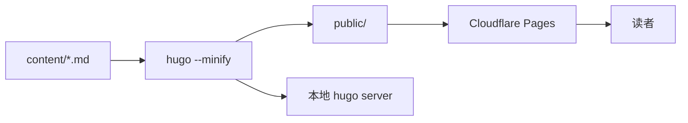

原来的方案是 Hexo + GitHub Actions + GitHub Pages。它没坏，只是每一条都恰好卡在我最难受的地方：国内打开慢、改一个错别字要等一趟 Action、主题和插件年久失修。于是这次干脆推倒重来，目标很明确——**写 IC 的内容，工具链要配得上这些内容**。

这篇文章记录搭建的完整过程，以及一路上真实遇到的报错和解决办法。你现在看到的这个站点，就是按下面的步骤跑出来的。

## 一、选型：为什么是 Hugo + PaperMod

先列需求，再选工具，避免为了「新」而换：

| 需求 | 选择 | 理由 |
|---|---|---|
| 构建快、长期可维护 | Hugo（extended） | Go 写的，几百篇也是秒级；单二进制，不依赖 Node 生态 |
| 公式 | KaTeX + Goldmark passthrough | 比 MathJax 快，排版干净；关键是别让 Markdown 先吃掉公式 |
| 框图 / 时序图 | Mermaid | 直接写在 Markdown 里，改图不用重新导出 PNG |
| 架构图、版图、波形 | 自写图片查看器 | 默认灯箱只能适配屏宽，IC 图里的小字根本看不清 |
| Manim 动画 | `video` 短代码 + WebM/MP4 | 当「会动的示意图」循环播放，比 GIF 小一个数量级 |
| 部署 | Cloudflare Pages | 连仓库自动构建，不用自己维护 workflow，国内访问通常好于 GitHub Pages |
| 成本 | 0 元 | 域名另算；备案和国内 CDN 是以后的事 |

主题选 [PaperMod](https://github.com/adityatelange/hugo-PaperMod)：单栏、中文支持完整、自带搜索/归档/目录，且仍在维护。它不花哨，但对「以读文字为主」的技术博客刚好。

## 二、把骨架搭起来

### 1. 安装 Hugo

Windows 上用 winget 最省事：

```powershell
winget install Hugo.Hugo.Extended
hugo version
```

版本号后面必须带 `+extended`。PaperMod 本身不一定用到 SCSS，但以后加图片处理、转 Sass 都靠它，装 extended 一劳永逸。

macOS 则是 `brew install hugo`。如果公司网络装不了包管理器，也可以直接下 `hugo_extended_<version>_windows-amd64.zip`，解压后把目录加进 `PATH`——这次我就是这么干的，原因见后面的踩坑第 2 条。

### 2. 初始化站点与主题

```bash
hugo new site ic-blog
cd ic-blog
git init
git submodule add https://github.com/adityatelange/hugo-PaperMod themes/PaperMod
```

主题有两种放法：

- **submodule**：仓库干净，升级一条 `git submodule update --remote`。但 Cloudflare Pages 构建时必须勾选/配置拉取 submodule，否则构建时报 `theme not found`。
- **直接把主题文件提交进 `themes/PaperMod`**：升级麻烦一点，但任何 CI 都不会缺文件。

这个站点用的是后者。个人博客一年也升不了几次主题，**构建稳定比升级优雅重要**。

### 3. 配置

配置写在 `hugo.yaml`，关键部分如下（完整文件在仓库根目录）：

```yaml
baseURL: "https://example.com/"
title: "IC 设计笔记"
theme: "PaperMod"
locale: "zh-CN"
defaultContentLanguage: "zh-cn"
hasCJKLanguage: true

permalinks:
  logs: "/logs/:slug/"
  cheatsheets: "/cheatsheets/:slug/"
  notes: "/notes/:slug/"
  essays: "/essays/:slug/"

outputs:
  home: ["HTML", "RSS", "JSON"]
```

`permalinks` 一定要在写第一篇文章之前定下来。以后换域名、换主题都可以，**文章 URL 变了，别人收藏的链接和搜索引擎的索引就全废了**。

栏目按「文章形态」分，而不是按学科分：

- `logs` 日志：踩坑记录、TIL
- `cheatsheets` 速查：命令、参数
- `notes` 笔记：论文、书
- `essays` 长文：复盘、教程

学科维度交给 tags（`#spectre`、`#calibre`、`#noise`）。分类保持稳定，标签随便加——这样每次写完不用纠结「这篇该放哪个栏目」。

目录最终长这样：

```text
.
├── archetypes/          # 四类文章的骨架
├── assets/
│   ├── css/extended/    # 自定义样式（主题会自动合并）
│   └── js/              # 图片查看器
├── content/
│   ├── logs/ cheatsheets/ notes/ essays/
│   ├── about.md search.md archives.md
├── layouts/
│   ├── _markup/         # ```mermaid 代码块钩子
│   ├── _partials/       # KaTeX、Mermaid、页脚扩展
│   └── _shortcodes/     # video、mermaid、env
├── static/videos/
├── themes/PaperMod/
└── hugo.yaml
```

## 三、公式：先让 Markdown 别乱动它

这是最容易翻车的一步。Goldmark 默认会把 `_` 当强调、把 `\` 当转义，于是 `$V_{th}$` 渲染出来是「V 斜体 th」，矩阵里的 `\\` 直接消失。**KaTeX 再强，也救不回已经被 Markdown 吃掉的源码。**

正确做法是开 passthrough，让公式原样透传给浏览器：

```yaml
markup:
  goldmark:
    extensions:
      passthrough:
        enable: true
        delimiters:
          block:
            - ["$$", "$$"]
            - ["\\[", "\\]"]
          inline:
            - ["$", "$"]
            - ["\\(", "\\)"]
```

然后在 `layouts/_partials/extend_head.html` 里按页加载 KaTeX：只有 front matter 写了 `math: true` 的文章才引入 CSS/JS，其余页面零开销。

```html
{{- if .Params.math }}
<link rel="stylesheet" href="https://cdn.jsdelivr.net/npm/katex@0.16.11/dist/katex.min.css">
<script defer src="https://cdn.jsdelivr.net/npm/katex@0.16.11/dist/katex.min.js"></script>
<script defer src="https://cdn.jsdelivr.net/npm/katex@0.16.11/dist/contrib/auto-render.min.js"></script>
{{- end }}
```

自动渲染的分隔符数组里，`$$` 必须排在 `$` 前面，否则 `$$...$$` 会先被单美元规则匹配掉一半。这个顺序问题很隐蔽，表现是「块级公式只渲染了开头」。

验证一下。比如 ADC 的理想信噪比：

$$
\mathrm{SNR_{dB}} = 6.02N + 1.76
$$

以及由 SNDR 反推有效位数：

$$
\mathrm{ENOB} = \frac{\mathrm{SNDR} - 1.76}{6.02}
$$

能正常显示，说明 passthrough 和 KaTeX 都通了。

> 单 `$` 做行内公式有个副作用：正文里写「$5 一片」会被当成公式开头。要么避开，要么统一改用 `\( ... \)`。

## 四、图表：Mermaid 要跟着明暗主题走

Mermaid 有两种写法。显式短代码：

```text

flowchart LR
  A[Markdown] --> B[Hugo]
  B --> C[public/]
  C --> D[Cloudflare Pages]

```

但更顺手的是让 ` ```mermaid ` 代码块直接生效。加一个渲染钩子 `layouts/_markup/render-codeblock-mermaid.html`：

```html
{{- partial "mermaid-assets.html" . -}}
<div class="mermaid-wrap">
  <pre class="mermaid">{{ .Inner | htmlEscape }}</pre>
</div>
```

`mermaid-assets.html` 里放 CDN 脚本和初始化代码，用 `.Page.Scratch` 保证一页只输出一次。**不要图省事把它塞进 `extend_footer.html`**：PaperMod 的页脚是 `partialCached` 缓存的，按页面判断的条件会被第一篇文章的结果冻住——这个坑我踩了，见第九节第 12 条。

真正的坑在主题切换。PaperMod 切暗色时只改 `document.documentElement.dataset.theme`，**页面不重载**，已经画好的 SVG 还是亮色配色，在深色背景上刺眼。解决办法是监听属性变化，把源码塞回去重画：

```js
const observer = new MutationObserver(() => {
  clearTimeout(timer);
  timer = setTimeout(render, 200);
});
observer.observe(document.documentElement, {
  attributes: true,
  attributeFilter: ["class", "data-theme", "style"]
});
```

`render()` 里先 `removeAttribute("data-processed")`，再把 `innerHTML` 还原成保存的源码，最后 `mermaid.run()`。不还原的话，Mermaid 会把 SVG 当成新源码再解析一次，直接报语法错。

效果：



## 五、视频：把 Manim 短片当「会动的示意图」

Manim 的输出有两个关键选择：

- **要透明背景**：MP4 容器不支持 alpha，必须用 `-t --format=webm`。WebM 的 VP9 透明通道浏览器支持很好，体积也远小于 MOV。
- **不要透明**：MP4 + H.264，兼容性最好，压一下码率即可。

```bash
# 透明背景：叠加在深浅色页面上都不突兀
manim -t --format=webm -qh scene.py AdcSampling

# 不透明：CRF 28 对合成动画几乎无损，体积能小一半以上
ffmpeg -i raw.mp4 -c:v libx264 -crf 28 -preset slow -an out.mp4
```

视频放 `static/videos/`，用短代码嵌入：

```text

```

短代码内部固定了 `autoplay muted loop playsinline` 四个属性。少一个都不行：**没有 `muted`，浏览器一定拦截自动播放；没有 `playsinline`，iOS 会强制全屏**。

一条建议：Manim 片段控制在 5–15 秒，只讲一个变化。它更像「会动的示意图」，而不是视频。

## 六、图片：IC 的图必须能缩放

这是我认为最值得自己写的一个功能。架构图、版图截图、波形图里全是小字，主题自带的灯箱只是把图片撑到屏幕宽——在 13 寸笔记本上，该看不清还是看不清。

需求很具体：

- 滚轮以**鼠标位置**为中心缩放，而不是以图片中心
- 按住拖动平移
- 移动端双指缩放
- 双击在 1x / 2.5x 之间切换
- 同一篇文章的图片可以用方向键翻
- `Esc` 关闭，不污染页面滚动

实现成一个无依赖的 `assets/js/image-viewer.js`，只绑定 `.post-content` 里的图片，小于 120px 的图标和表情自动跳过。核心是缩放锚点的换算：

```js
const rect = img.getBoundingClientRect();       // 已包含 translate/scale
const cx = rect.left + rect.width / 2;
const dx = px - cx;
tx = tx + dx - (dx / scale) * nextScale;        // 让指针下的内容不动
```

一开始我写成了 `(px - cx - tx) / scale`，结果每缩放一次图片就往外飘一段——`getBoundingClientRect()` 返回的已经是变换后的矩形，再减一次 `tx` 就重复计算了。这类坐标问题没有捷径，拿一张网格图慢慢试最快。

CSS 里给可放大的图加 `cursor: zoom-in`，打开后锁住 `html` 的滚动；`prefers-reduced-motion` 下关掉所有动画。

## 七、写作模板：把「总结」降级成「填空」

工具搭好只是第一步，真正让人放弃的是空白页。所以四类文章都在 `archetypes/` 里固定了骨架：

```bash
hugo new content logs/calibre-drc-2026.md --kind log
hugo new content cheatsheets/spectre-noise.md --kind cheatsheet
hugo new content notes/paper-xxx.md --kind note
hugo new content essays/adc-review.md --kind essay
```

以踩坑记录为例，生成的文件直接带好：

```markdown
## 现象
## 环境
## 排查过程
## 根因
## 解决
## 教训
```

打开文件只需要往里填，不用面对空白页，也不用想「这篇文章该怎么组织」。这就是把「创作」降级成「填空」的全部意义。

## 八、部署到 Cloudflare Pages

1. 推到 GitHub（公开/私有都行）。
2. Cloudflare Dashboard → **Workers & Pages** → **Create** → **Pages** → **Connect to Git**。
3. 构建参数：
   - Build command：`hugo --minify`
   - Build output directory：`public`
   - 环境变量：`HUGO_VERSION = 0.168.0`
4. 之后每次 `git push` 自动构建发布。

两个容易卡住的地方：

- **主题是 submodule 时**，Cloudflare 默认不拉取子模块，构建会报 `module "PaperMod" not found`。要么在设置里开启 submodule，要么像本站一样把主题提交进仓库。
- **新版 Workers 静态资源**：如果项目走的是 Workers 而不是经典 Pages，构建产物目录要在仓库根目录的 `wrangler.jsonc` 里声明，且 `name` 必须和项目名完全一致（小写）：

```jsonc
{
  "name": "ic-blog",
  "compatibility_date": "2026-10-01",
  "assets": {
    "directory": "./public",
    "not_found_handling": "404-page"
  }
}
```

以后如果国内访问是硬指标，再把同一份仓库接到腾讯云 EdgeOne Pages，绑定已备案域名即可；构建命令完全一样，换的只是托管方。

## 九、真正踩到的坑

按遇到的时间顺序记，每条都附上现象和解决办法。

### 1. 写文件时报 `SetNamedSecurityInfoW failed (Win32 5)`

**现象**：在这个目录里创建/写入文件直接被拒，连列目录都失败。

**根因**：Windows 上该目录的权限项里，当前用户缺少 `WRITE_OWNER`。工具在给工作区加访问权限时被系统拒绝。

**解决**：先备份权限，再给当前用户完全控制：

```powershell
icacls "D:\user\blog" /save "acl-backup.txt" /t
icacls "D:\user\blog" /grant "$env:USERNAME:(OI)(CI)F"
```

`(OI)(CI)` 让权限继承到子目录和文件，`F` 是完全控制。改完立刻重试原操作，不要先重启工具。

### 2. GitHub 下载全部失败：`SEC_E_NO_CREDENTIALS`

**现象**：`curl` 和 `Invoke-WebRequest` 都报 `schannel: AcquireCredentialsHandle failed: SEC_E_NO_CREDENTIALS`，浏览器却能正常打开。

**根因**：Windows 的 Schannel 在 TLS 握手时拿不到可用的客户端凭据（代理软件、证书存储、系统 TLS 配置都可能触发）。这不是网络不通，是 TLS 实现的问题。

**解决**：换一个不走 Schannel 的客户端。这次用 Python 的 `urllib`（OpenSSL）直接流式下载，顺便加了三次重试：

```python
with urllib.request.urlopen(req, timeout=45) as r, open(dest, "wb") as f:
    while chunk := r.read(256 * 1024):
        f.write(chunk)
```

23MB 的 Hugo 包直连 GitHub 仍会中途超时，最后挂了个镜像前缀才下完。**遇到「浏览器能开、命令行不能下」，先怀疑 TLS 栈，不要怀疑 DNS。**

### 3. 覆盖主题模板不生效

**现象**：`layouts/partials/extend_head.html` 写好了，页面里完全没有输出，也没有报错。

**根因**：Hugo 0.146 之后模板目录改成 `layouts/_partials/`、`layouts/_markup/`；新版 PaperMod 已经迁过去了。旧路径不会报错，只是**根本不会被查找**。

**解决**：把覆盖文件放到与主题相同的 `_partials` / `_markup` 路径下。判断方法很简单：看主题里那个文件在哪，你的覆盖就放哪。

### 4. `languageCode` 弃用警告

**现象**：构建时提示 `project config key languageCode was deprecated in Hugo v0.158.0`。

**解决**：改用 `locale: "zh-CN"`，`defaultContentLanguage` 保持语言键 `zh-cn` 不变。警告不影响构建，但会一直刷屏。

### 5. 公式里的下划线变成了斜体

**现象**：`$V_{th}$` 显示成「V 斜体 th」，矩阵的换行 `\\` 消失。

**根因**：Goldmark 先于 KaTeX 解析，`_` 和 `\` 被当成 Markdown 语法。

**解决**：开 `passthrough`，并把 `$$` 排在 `$` 前面。改完记得清一次 `resources/`，Hugo 会缓存渲染结果。

### 6. Mermaid 在暗色模式下仍然是白底

**现象**：切换主题后页面变黑，图还是亮色。

**根因**：PaperMod 只改 `html[data-theme]`，页面不重载，SVG 不会自动重绘。

**解决**：`MutationObserver` 监听 `data-theme`，把源码写回 `<pre>` 后重新 `mermaid.run()`。细节见第四节。

### 7. 图片点了没反应，或者直接跳转

**现象**：给图片套了 `<a>` 之后，点击打开的是原图链接，查看器不出现。

**解决**：在内容区做事件委托，命中 `img` 时 `preventDefault()` + `stopPropagation()`；同时用 `naturalWidth >= 120` 过滤小图标，并支持 `data-nozoom` 手动排除。

### 8. 视频不自动播放

**现象**：`autoplay` 写了，页面加载后仍然停在第一帧。

**根因**：浏览器的自动播放策略要求同时满足 `muted` 和 `playsinline`。

**解决**：短代码里固定这两个属性；需要声音的视频改为 `autoplay="false"`，让用户主动点。

### 9. Cloudflare 构建找不到主题

**现象**：本地 `hugo` 正常，云端报 `module "PaperMod" not found`。

**根因**：主题是 submodule，构建环境没有拉取子模块。

**解决**：开启 submodule 拉取，或把主题文件直接提交。本站选了后者，代价是升级要手动替换。

### 10. 首页一篇文章都不显示

**现象**：文章构建成功、URL 能直接访问，但首页只有自我介绍，列表是空的。

**根因**：PaperMod 首页用 `where site.RegularPages "Type" "in" site.Params.mainSections` 过滤，`mainSections` 默认是 `["posts"]`。而 front matter 里写了 `type: log`，页面的 `.Type` 变成单数 `log`，和栏目 `logs` 对不上，于是被过滤掉。

**解决**：在 `params` 里显式声明：

```yaml
params:
  mainSections: ["logs", "cheatsheets", "notes", "essays"]
```

同时删掉多余的 `type:`——Hugo 默认就用 section 名当 type，不需要手写。

### 11. 文章明明存在，`public/` 里却没有

**现象**：`hugo list all` 能看到这篇文章，`hugo` 也不报错，但构建产物里没有它的目录。

**根因**：front matter 的 `date` 比当前时间晚了 25 分钟，而 `buildFuture: false`——Hugo 把「未来文章」静默跳过了。

**解决**：把日期改到现在之前，或临时加 `--buildFuture` 验证。CI 机器一般是 UTC，写 `+08:00` 偏移量就不会被时区坑到。

### 12. Mermaid 有时加载、有时不加载

**现象**：同一篇带图的文章，刷新几次结果不一样；先打开别的页面，再进来就不出图。

**根因**：PaperMod 的 `baseof.html` 用 `partialCached "footer.html" . .Layout .Kind ...` 缓存页脚，`extend_footer.html` 里的「本页是否有 Mermaid」只在缓存第一次生成时求值，之后被所有同类页面复用。

**解决**：不要在 `partialCached` 的 partial 里做按页判断。把 Mermaid 的资源加载放到短代码 / 渲染钩子旁边，用 `.Page.Scratch` 做页内去重：

```html
{{- if not (.Page.Scratch.Get "mermaidAssetsLoaded") -}}
  {{- .Page.Scratch.Set "mermaidAssetsLoaded" true -}}
  ...
{{- end -}}
```

## 十、验证清单

上线前逐项过一遍，比上线后再修便宜得多：

- [ ] `hugo --minify` 无报错、无警告
- [ ] 手机窄屏下代码块能横向滚动，表格不撑破页面
- [ ] 明暗主题切换后，Mermaid 和代码高亮都跟着变
- [ ] 带 `math: true` 的文章公式正确，不带的不加载 KaTeX
- [ ] 图片可以滚轮缩放、拖动、双指缩放，`Esc` 能关
- [ ] 视频在 iOS Safari 上不强制全屏
- [ ] `/index.xml`、`/sitemap.xml`、`/404.html` 都能访问
- [ ] 随便点开一篇文章，URL 与 `permalinks` 预期一致

## 最后

这套东西没有任何服务器要维护，成本是零（域名除外）。它不完美：搜索是前端 Fuse.js，文章多了会变慢；评论系统还没接；国内访问仍然依赖 Cloudflare 的线路。

但它解决了我最在意的问题——**写一篇踩坑记录只要 15 分钟，`git push` 之后不用管任何事**。工具链退到背景里，注意力才能回到电路上。

下一篇会是一篇真正的 IC 踩坑记录，用来检验这套模板是不是真的「填得动」。
